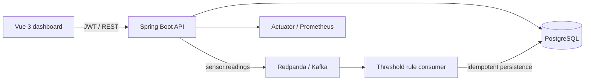
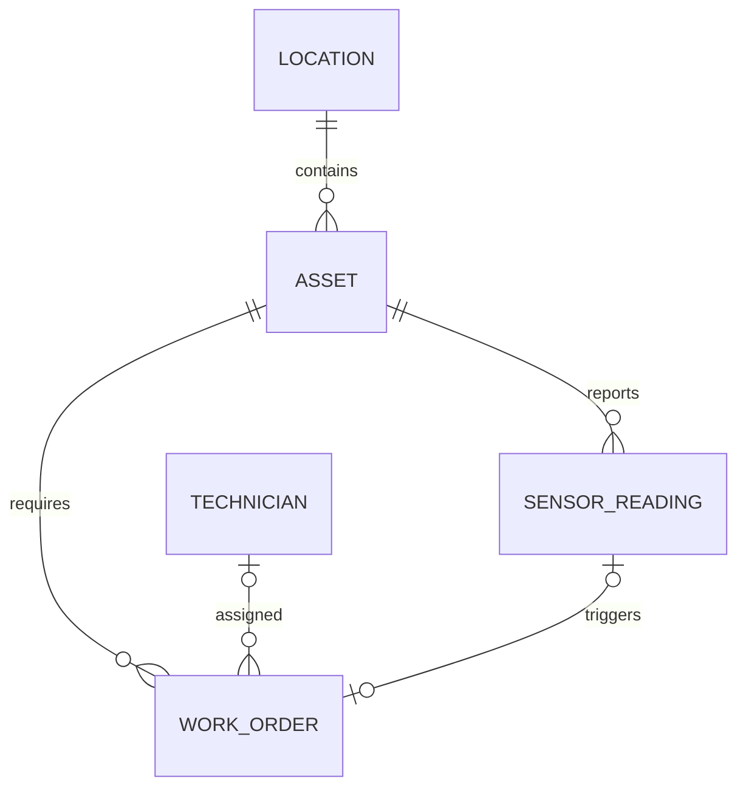

# AssetPulse

AssetPulse is an asset maintenance and work-order platform. It combines a Spring Boot API, PostgreSQL, Redpanda-compatible Kafka messaging, and a Vue 3 dashboard.

## Architecture

Sensor readings are accepted by the API and published to Kafka. The consumer persists each event once, checks the asset's configured threshold, and opens a work order when the reading is high. Work orders can then be assigned and moved through `OPEN → ASSIGNED → IN_PROGRESS → DONE`.

The dashboard also offers a predictive-maintenance threshold suggestion when at least five readings exist for an asset and metric. It uses a transparent mean-plus-two-standard-deviations heuristic over the latest 50 readings; it never changes the configured threshold automatically and sends no data to an LLM.

## Run locally

Prerequisites: Docker Compose, Java 21, Maven, and Node.js 20+.

1. Copy `.env.example` to `.env` and set a private `APP_JWT_SECRET` (at least 32 characters).
2. Start the stack: `docker compose up --build`.
3. Open the dashboard at <http://localhost:5173> and API docs at <http://localhost:8080/swagger-ui.html>.
4. Sign in with the local bootstrap account from `BOOTSTRAP_USERNAME` / `BOOTSTRAP_PASSWORD` in `.env`.

PostgreSQL and Redpanda are exposed on ports 5432 and 9092. The API is at `http://localhost:8080`; Prometheus metrics are at `/actuator/prometheus`.

To run the backend without containers, start PostgreSQL and Kafka-compatible Redpanda, then run `mvn spring-boot:run` from `backend`. Run the UI with `npm install` and `npm run dev` from `frontend`.

## Test

Run `mvn test` from `backend` (the PostgreSQL integration test uses Testcontainers and needs Docker). Run `npm ci` and `npm run build` from `frontend`.

## Main API

| Method | Path | Purpose |
|---|---|---|
| POST | `/api/auth/login` | Exchange username/password for a JWT |
| GET, POST | `/api/assets` | List and create assets |
| GET, PUT, DELETE | `/api/assets/{id}` | Read, update, and remove an asset |
| GET, POST | `/api/work-orders` | Filter/list and create work orders |
| PATCH | `/api/work-orders/{id}/status` | Advance or complete a work order |
| POST | `/api/sensor-readings` | Publish a sensor reading for asynchronous processing |
| GET | `/api/assets/{id}/maintenance-insight?metric=temperature` | Suggest a threshold from recent readings |
| GET | `/actuator/health` | Health probe |
| GET | `/actuator/prometheus` | Prometheus metrics |

API requests other than login and health/docs require `Authorization: Bearer <token>`. Work-order state changes are validated by the API.

## Development and delivery

- Database schema is managed by Flyway in `backend/src/main/resources/db/migration`.
- Focused backend tests use JUnit 5 and Mockito; integration-test dependencies include Testcontainers for PostgreSQL and Kafka.
- `.github/workflows/ci.yml` runs backend tests and frontend checks/builds.
- `deploy/openshift/` contains OpenShift-compatible Kubernetes resources. It expects PostgreSQL and Kafka/Redpanda endpoints to be provided. Create the `assetpulse-secrets` secret and update image references, the API route, and frontend `VITE_API_URL` / API CORS origin for your cluster before applying.
- `backend/Dockerfile` and `frontend/Dockerfile` use multi-stage builds.

## AI-assisted development

Built with GitHub Copilot in VS Code: Copilot-assisted iteration was used for the domain model, API implementation, focused tests, and dashboard polish. The maintenance insight is an explainable statistical rule suggestion rather than an LLM call; it does not transmit asset or sensor data to a third party.
